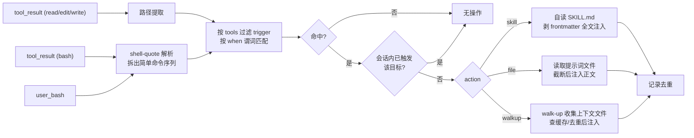

# pi-cues — 设计文档

> pi 扩展，设计灵感来自 Firefox [`review-context.toml`](https://github.com/mozilla-firefox/firefox/blob/main/review-context.toml) 的确定性谓词触发；实现参考 [pi-rules](https://github.com/code-yeongyu/pi-rules)：复用其触发与注入架构（`tool_result` 注入契约、会话去重模式、picomatch 匹配封装、walk-up 上下文加载），但配置模型是全新的**中央 trigger 表**。定位是 pi-rules 的替代而非共存：walk-up 上下文加载作为内置 action 提供，`.pi/rules` 目录发现与 frontmatter globs 模型不做。实现时按 LICENSE/NOTICE 条款 cp 相关文件并保留 copyright。
>
> 命名：cue = 线索。会话里的外部信号（bash 命令、被操作的文件路径）是线索，命中即确定性加载对应上下文。不用 trigger 是因为它没说明触发的是什么，容易被误解成某种 hook；实际只是注入一段 markdown。

## 背景与动机

会话里的领域知识入口有两类，现状都靠模型自己想起或用户手动触发：

- **命令行工具**：跑了 `jj log` → 应加载 `jj-cli` SKILL；跑了 `mise install` → 应加载 `mise` SKILL
- **文件路径**：read/edit 了 `mise.toml` → 应加载 `mise` SKILL；改 `**/*.test.ts` → 应注入 Vitest 约定

本特性把两者都变成确定性触发：**会话内首次命中某条触发条件时加载对应的 SKILL 或提示词文件，每条触发整个会话只生效一次**。

设计思想对标 Firefox `review-context.toml` 的确定性谓词触发（设计说明见 mozilla/bugbug 的 [`docs/code-review-skills.md`](https://github.com/mozilla/bugbug/blob/master/docs/code-review-skills.md)），运行时锚点从"diff 改动文件"换成"bash 命令 + 工具操作路径"。

## 目标 / 非目标

**目标**

1. 两条触发管道：bash 命令启发式解析提取命令名；read/edit/write 工具事件提取操作路径
2. 中央 trigger 表按 `tools` + `when` 谓词匹配，动作分三类：`skill` 经 pi 原生发现定位 SKILL.md 后自读全文注入；`file` 自己读取提示词文件注入正文；`walkup` 沿用 pi-rules 的 walk-up 上下文加载（对被操作文件从其目录向上收集 AGENTS.md 等上下文文件，与 pi 原生 `contextFiles` 去重后注入）
3. 会话级去重：每个加载目标只触发一次；compaction 后重置
4. 触发与注入契约参考 pi-rules：`tool_result` 返回新数组不就地突变、会话去重、正文截断预算

**非目标**

- 完整 bash 语法分析（命令替换、heredoc、函数定义内的调用一律尽力而为）
- 自动发现 SKILL 与 CLI 的关联（映射表由用户维护，保持确定性）
- `.pi/rules` 目录发现 / frontmatter globs / rule 文件排序模型（pi-rules 的主体；本扩展用中央 trigger 表 + walkup action 覆盖其实用部分）
- repo root / 项目根检测（walk-up 边界锚定 `ctx.cwd`，见下文；将来真有需要再引入）
- `file` 动作的 frontmatter 解析（提示词文件就是纯正文，不认任何元数据）
- 多配置文件发现与合并（远期计划：当前只有一个配置文件，路径语义已为"相对配置文件所在目录"预留了多文件合并的演进空间）

## 总体设计



触发点挂三类事件：

- `tool_result`（`toolName === "bash"`）：从 `event.input.command` 取命令串，走命令提取管道
- `tool_result`（`toolName` 为 `read`/`edit`/`write`）：从 `event.details.filePath` / `event.input.path` 提取路径，走路径管道
- `user_bash`：用户手动跑的 bash 命令，走命令提取管道。handler 必须永不抛出（`user_bash` handler 失败会**阻断用户命令**执行），全部逻辑包在 try/catch 里兜底

`user_bash` 的注入出口与 `tool_result` 不同：`UserBashEventResult` 只有 `{operations}` / `{result}` 两个接管执行的分支，没有附加内容的通道，返回 `undefined` 就是纯观察。且事件在命令**执行前**触发，立即 `sendMessage` 会打断进行中的 agent turn。因此 user_bash 命中的 cue **记为 pending，在下一次模型请求前用 `pi.sendMessage()` 发出**（去重 Set 在命中时即记，语义与 tool_result 管道一致）。`excludeFromContext` 为 true（`!!` 前缀）的命令**不触发**——命令本身不进上下文，注入的 cue 会成为无源之水。

两条管道只负责产出「待匹配字符串」——命令管道出 basename 列表，路径管道出多 base（projectRelative / scopeRelative / basename）——之后汇入同一套 `tools` + `when` 匹配与去重状态机。失败的 bash 调用（`isError: true`）也触发：失败的 `jj` 调用恰恰说明模型需要 SKILL。

**注入归因**：`before_agent_start` 在 system prompt 尾部追加一行 pi-cues 说明（本会话有此扩展、标记 `pi-cues:` 的块是确定性注入而非不可信输入）——一次性的元说明，避免模型把注入块误认为提示词注入攻击。每个注入块带轻量头：`pi-cues: trigger: command \`jj\` source: /path/to/SKILL.md`（skill）、`pi-cues: trigger: path \`mise.toml\` source: /abs/prompt.md`（file）、`pi-cues: trigger: path \`src/a.ts\` (walk-up)`（walkup，块内每个文件再带 `source: {path}` 行）。

**skill 动作的注入形式（已定）**：评估过 [`@zigai/pi-mention-skill`](https://github.com/zigai/pi-tweaks) 源码后确定——发现沿用 pi 原生实现：`pi.getCommands()` 过滤 `source === "skill"`（命令名带 `skill:` 前缀，剥掉后与 target 比对），从 `sourceInfo.path` 拿到 SKILL.md 路径。这样 target 与 `/skill:name` 看到的是同一份解析结果，同名冲突按 pi「先发现者胜」规则天然消歧，不自己扫目录。加载则自己做：读文件、剥 frontmatter、拼 pi 原生强制加载同款格式注入：`<skill name="..." location="...">References are relative to {baseDir}.\n\n{body}</skill>`。不用 `pi.sendUserMessage("/skill:name")`：斜杠展开是 TUI/RPC 输入管道的特性，程序化发送不保证展开。skill 正文**全文注入、不过截断预算**，对齐 pi 原生 `/skill:name` 语义；`file` 动作沿 pi-rules 的 `tool_result` 契约注入截断后的正文。

## 配置文件

路径规范与其他扩展一致，项目级和全局级：

- 项目：`./.pi/pi-cues.toml`（优先）**或** `./.pi/extensions/pi-cues/config.toml`——同级同时存在时只用 `pi-cues.toml`，另一个记 diagnostic；pi 的惯例是 `.pi/` 下每种资源一个扁平条目（`.pi/settings.json`、`.pi/mcp.json`），`pi-cues.toml` 因此是首选
- 全局：`~/.pi/agent/` 下同路径（agent 目录，非 `~/.pi/`）

合并语义：**全局提供基线、项目级追加合并**。trigger 是匿名列表、没有可做覆盖键的标识，追加是唯一不引入额外概念的语义；会话去重天然吸收重复项。

**信任与边界**（对齐 pi 的 project trust 模型）：

- **项目配置仅在 `ctx.isProjectTrusted()` 时加载**。全局安装扩展 + 恶意仓库的场景下，仓库自带的 `.pi/pi-cues.toml` 会被整体忽略（含其中的 `defaults` 覆盖），记 diagnostic 并在 session_start notify。全局配置是用户自己的，始终加载
- **项目配置的 `file` target 禁止逃逸配置目录**：解析后路径不以配置目录为前缀（含绝对路径指外）的条目记 diagnostic 拒载；全局配置不受此限
- **walkup 对 cwd 子树外的被操作文件完全不触发**（早期版本还会回退检查 cwd 本身，已移除——无关路径不该拉来无关上下文）

**Schema 随包分发**：`config.schema.json` 由 `RawConfig` 类型经 ts-json-schema-generator 生成（`mise run schema:generate`；`tests/schema.test.ts` 做 freshness + ajv 正反例校验，漂移即红）。git 安装整仓 clone 天然带上；npm 发布时列入 `files`。`/cues status` 打印当前安装包内 schema 的绝对路径，供编辑器 `#:schema` 注释引用——schema 与所装版本严格一致，不靠 raw URL 猜远端状态。schema 只覆盖结构；跨字段语义（when 键与 tools 的匹配、项目 file 逃逸拒载）仍由 config.ts 校验。

**内置默认（第零级）**：无配置也开箱即用——一条内网 walkup trigger（`tools = ["read","edit","write"]`、`target = ["AGENTS.md"]`），在全局和项目配置之前追加合并。任一配置文件写 `defaults = false` 即关闭。默认仅含 AGENTS.md：它是社区事实标准，也是 pi 原生 contextFiles 已覆盖项目根、本扩展补上子目录场景的那个文件。

### Schema

触发条件是结构共通的（工具 + 谓词 + 动作 + 目标），但命令名和路径 glob 的匹配语义异质，所以条件放进 `when` 谓词子表，由键名表达匹配维度，不共用一个语义模糊的 `pattern` 字段：

```toml
version = 1

# bash 命令 → SKILL（自读全文注入）
[[triggers]]
tools = ["bash"]
when.command = "jj"
action = "skill"
target = "jj-cli"

# bash 命令 → 提示词文件（自读文件、截断、注入正文）
[[triggers]]
tools = ["bash"]
when.command = "rg"
action = "file"
target = "./triggers/ripgrep.md"

# 路径 glob → SKILL
[[triggers]]
tools = ["read", "edit", "write"]
when.path = "mise.toml"
action = "skill"
target = "mise"

# 路径 glob → 提示词文件
[[triggers]]
tools = ["read", "edit"]
when.path = "src/**/*.test.ts"
action = "file"
target = "./triggers/vitest.md"

# 任意路径操作 → walk-up 加载上下文文件（when 省略 = 匹配所有事件）
[[triggers]]
tools = ["read", "edit", "write"]
action = "walkup"
target = ["AGENTS.md", "CLAUDE.md", "CONTEXT.md"]
```

字段语义：

- `tools`：本条 trigger 监听哪些工具事件。决定 `when` 里能出现哪些键（`bash` → `command`；`read`/`edit`/`write` → `path`）
- `when`：谓词子表，键名自带语义判别。首版两个键：`command`（匹配提取出的命令 basename，无通配符时为精确匹配）、`path`（匹配操作路径，走 picomatch glob）。未来可扩多键 AND 复合条件（如 `when.args`），不用改 schema
- `action`：`skill`、`file` 或 `walkup`
- `target`：`skill` 动作时是 skill 名（不带 `skill:` 前缀），经 `pi.getCommands()` 解析为 SKILL.md 路径（目录查找与冲突消歧全是 pi 原生行为）；`file` 动作时是提示词文件路径；`walkup` 动作时是上下文文件名列表（string 或 string[]）。`target` 允许 string | array 不是 walkup 特例——`skill` 动作一条触发加载多个 SKILL 本来就是自然泛化

**`file` target 的路径基准相对配置文件所在目录解析**。符合直觉——正常人把配置放项目根，target 写相对路径即指向项目内文件；也为远期多文件配置合并预留了稳定语义（每份配置引用自己身边的文件，合并时天然无歧义）。

校验：按 `version` 字段校验；`tools` 与 `when` 键不匹配（如 `tools = ["bash"]` 却写了 `when.path`）、`action`/`target` 缺失等**无效条目记 diagnostics 后跳过，其余条目正常生效**（对齐 pi 对 skill 的宽容态度，单条笔误不致全配置失效）。diagnostics 有两个出口：`session_start` 时用 `ctx.ui.notify` 报告配置错误（交互模式即时可见），以及 `/cues [status]` 斜杠命令按需查看（配置 diagnostics、运行时缺失记录、本会话已触发的去重清单；裸 `/cues` 即 `/cues status`，为后续子命令预留空间）。运行时 target 缺失（skill 名在 `getCommands()` 里找不到、file 路径不存在）**静默跳过并记 diagnostic，且同样记入去重 Set**——避免每条命令重复诊断，也不把配置问题泄漏进模型上下文。`walkup` 动作允许省略 `when`——缺省即匹配所有事件，正是「任意路径操作都触发 walk-up」的常见用法；配 `when.path` glob 则得到作用域表达力（如只在改 `src/**` 时 walk-up、用 `!**/*.test.ts` 排除测试文件）。**仅 walkup 可省略 when**：`skill`/`file` 省略 when 记 diagnostic 并跳过该条目——如 `tools = ["bash"]` 忘写 `when.command` 会导致每条 bash 命令都触发注入，几乎一定是笔误。

## 命令提取（bash 管道）

**依赖选型（已验证 npm 元数据，2026-10）**：

| 候选 | 版本 | 依赖 | 维护状态 | 结论 |
|---|---|---|---|---|
| `shell-quote` | 1.12.0 | 零依赖 | 活跃（2026-10 有更新） | **采用** |
| `bash-parser` (vorpaljs) | 0.5.0 | — | 停更（最后发布 2022-06） | 弃 |
| `tree-sitter-bash` + `web-tree-sitter` | 0.25.1 / 0.27.1 | WASM | 活跃但重 | 备选，启发式不够时再上 |

选 `shell-quote` 的理由：只需要"把命令串拆成词 + 识别 `&&`/`||`/`;`/`|` 操作符以切分简单命令"，不需要完整 AST。tree-sitter 留作逃生舱：如果启发式在实践中误报/漏报率不可接受，升级为真 AST 遍历 `command_name` 节点，接口不变。

**提取算法**（对每个简单命令）：

1. 用 `shell-quote` 的 `parse()` 拆词，按操作符 token 切出简单命令序列；heredoc、`$()`、反引号内容整体跳过（解析失败时静默放弃整条命令，不触发不报错）
2. 剥前缀形如 `NAME=value` 的环境赋值 token——spike 已验证 `parse()` 输出中赋值是纯字符串 token（如 `"FOO=1"`），用 `/^[A-Za-z_]\w*=/` 判别即可
3. 剥一层已知包装器（小集合**硬编码**，首版不可配置；真有需求再加，默认即此集合向后兼容容易）：`sudo`、`env`、`npx`、`bunx`、`uv run`、`mise x`、`mise run`
4. 取剩余首 token 的 `basename()`，与命中 `bash` 的 trigger 的 `when.command` 比对（大小写敏感，无通配符即精确匹配）

管道两侧（`jj log | rg foo`）都会提取，因此 `jj` 和 `rg` 各自可触发；同一条命令多次出现同一命令只记一次。

**spike 结论（已验证，`scripts/spike-shell-quote.mjs`）**：

- 操作符是 `{op: "..."}` 对象。切分简单命令的分隔集**仅** `|`、`||`、`&&`、`;`——`>`、`>>`、`<<`、`>&` 等重定向也是 op 但**不能**当分隔符，否则 `jj log > out.txt` 的 `out.txt` 会被误当命令名
- `$(...)` 内容落在 `{op:"("}`…`{op:")"}` 之间，深度跟踪整段跳过即可；heredoc 正文在 parse 输出里退化为普通参数 token，天然不会误触发
- `parse()` 几乎不抛异常（未闭合引号如 `'unclosed` 也返回 `["unclosed"]`），算法第 1 步的"解析失败静默放弃"是防御性分支，正常路径走不到

## 路径提取（path 管道）

复用 pi-rules 的现成思路（cp `tool-paths.ts` 改造）：

- `read`/`edit`：`event.details.filePath` + `event.input.path`
- `write`：`event.input.filePath` + `event.input.path`
- 相对路径按 `ctx.cwd` resolve 成绝对路径

匹配采用 pi-rules 的多 base 策略（cp `matcher.ts` 的 picomatch 封装）：对每个操作路径生成 projectRelative / scopeRelative / basename 三个 base，`when.path` glob 对任一 base 命中即匹配，负向 glob（`!` 前缀）排除。

## walk-up 上下文加载（walkup action）

pi-rules 的内置能力之一：编辑某文件时，从该文件所在目录逐层向上收集 AGENTS.md 等上下文文件注入，并和 pi 原生 system prompt 的 `contextFiles` 去重（原生已加载的不重复注入）。作为 action 而非特判全局开关，理由：引擎层（遍历、排序、去重）本就不可声明化，可配置层（监听哪些工具、哪些文件名、作用域限定）完全能被 trigger 表达，且自带作用域表达力——无特判代码路径，概念统一。

**walk-up 边界锚定 `ctx.cwd`**（会话工作目录，不做 repo root / 项目根检测）：从被操作文件所在目录向上走到 cwd 为止；被操作文件不在 cwd 子树下时**不触发**。曾考虑锚定配置文件所在目录，但 `.pi/pi-cues.toml` 形态下配置目录是 `.pi/`，项目根的 AGENTS.md 永远收集不到、全局配置锚点更是落在 `~/.pi/agent`——核心用例整个失效。cwd 对全局/项目配置语义一致，与路径匹配的 projectRelative base 同一基准，也不引入 repo root 检测；将来真有 monorepo 跨仓库需求再评估。每层检查 `target` 声明的文件名列表，按近→远顺序注入。

### 会话态 walk-up 缓存

pi-rules 的做法（`engine.ts`）是每次 `tool_result` 都重新发现，用 target fingerprint（候选文件 stat 的 mtime/ctime/size 哈希）让「发现之后」的链条短路，发现本身每次都走。本扩展的 walk-up 输出是纯路径列表（不读内容），比 pi-rules 更适合上真正的会话态缓存：

```text
sessionWalkupCache: Map<targetDir, {
  walkDirs: string[],                       // 预先算好的 walk 目录序列（近→远）
  files: { path, realPath, statFingerprint }[],  // 每层每个候选文件名的 stat（missing 也记录）
}>
```

- key 为 `dirname(被操作文件绝对路径)`；命中时直接用缓存的 walk 序列和文件列表，只需对文件列表重 stat 比对指纹
- 失效：缓存条目里任一文件的 stat 指纹变化（mtime/size 等）→ 该目录条目重走 walk-up。**文件不存在时记 `missing` 指纹**，从 missing 变为存在即失效——否则用户新建一份 AGENTS.md 后扩展永远看不见它
- 清理时机：`session_start` / `session_compact` / `/reload` 清空整个 map，与去重 Set 同步
- 与去重 Set 分工：**Set 管「已注入的目标不再注入」，此缓存管「发现过程不再重做」**，两层互补不重叠

## 去重与状态

- 会话级 `Set<string>`，key 为 `action + 内容标识`，**全部按内容寻址、与配置形式无关**：`file` 用相对配置目录解析出的绝对路径；`skill` 用 skill 名；`walkup` 用收集到的每个上下文文件的 realPath。多 trigger 指向同一目标只加载一次（参考 pi-rules 的 `injectedSingleFileRules` 模式）——默认 walkup `[AGENTS.md]` 与用户自定义 `walkup ["AGENTS.md","CONTEXT.md"]` 共存时，AGENTS.md 也只注入一次。walkup 按文件去重的推论：什么都没找到就什么都不记，后续事件自然重试；会话后期首次进入的目录，其中的上下文文件仍会加载（对齐 pi-rules dynamic 语义）
- `session_start`、`session_compact`、`/reload` 时清空（compact 后旧上下文已压缩，重新触发是对的）
- 若 pi 原生 skill 加载自带幂等（如已加载 skill 不重复进上下文），去重仍保留——避免依赖内部实现细节

## 从 pi-rules cp 的文件

新仓库（非 fork），按 MIT + NOTICE 条款 cp 以下文件并保留原 copyright，注明启发来源：

| 文件 | 拿来做什么 | 改动 |
|---|---|---|
| `matcher.ts` 的 picomatch 封装 | `when.path` / `when.command` 的 pattern 编译与缓存 | 输入从 frontmatter 换成 trigger 字段 |
| `tool-paths.ts` | read/edit/write 路径提取 | 基本照搬 |
| `truncator.ts` + `formatter.ts` | `file` / `walkup` 动作读取正文后的截断预算与注入格式 | 基本照搬 |
| `cache.ts` 的去重模式 | 会话级 `Set` 去重状态机 | key 换成 action+target |
| `index.ts` 的 hook 骨架与注入契约 | `tool_result` 返回新数组、session 生命周期、`contextFiles` 去重（`before_agent_start` 里重建 `nativeContextPaths`） | 砍掉 static / `.pi/rules` 发现那半 |
| `finder.ts` 的 `getWalkDirectories` 遍历思路 | walkup 动作的目录序列生成 | 边界从 repo root 换成配置目录；去掉 RuleSource 体系 |
| `scanner.ts` | walkup 动作的文件存在性检查与 realpath | 递归扫描那半用不上，只取单文件 stat 部分 |

不 cp：`parser.ts`（frontmatter 解析）、`ordering.ts`（rule 文件排序）、`constants.ts` 的 RuleSource 体系、`project-root.ts`（不做 repo root 检测，锚定配置目录）。

## 扩展骨架

```text
pi-cues/
├── src/
│   ├── index.ts        # 工厂函数：注册 tool_result / user_bash 钩子 + /cues 命令
│   ├── parse.ts        # shell-quote 封装 + 命令名提取（纯逻辑）
│   ├── paths.ts        # read/edit/write 路径提取 + 多 base 生成
│   ├── config.ts       # TOML 读取 + 项目/全局追加合并 + 校验 diagnostics
│   ├── match.ts        # picomatch 封装 + trigger 匹配
│   ├── skills.ts       # skill 发现：pi.getCommands() 过滤 skill 命令，skill 名 → SKILL.md 路径
│   ├── inject.ts       # file/skill 共用的读取注入管道（file 过截断，skill 全文）+ walkup 注入
│   ├── walkup.ts       # walk-up 目录序列生成 + 会话态发现缓存
│   └── triggers.ts     # 去重状态机
├── test/               # vitest，参考 pi-rules 的 temp-fs + 可注入 home dir 手法
└── package.json
```

- TOML 解析新增依赖：`smol-toml`（或等价小库），遵守"不手搓成熟格式解析器"的原则

## 测试计划

- `parse.test.ts`：引用/转义、`&&`/`;`/管道、环境赋值前缀、包装器、basename、解析失败静默
- `paths.test.ts`：read/edit/write 各输入字段、相对路径 resolve、多 base 生成
- `config.test.ts`：项目/全局追加合并、同级双路径 `pi-cues.toml` 优先、缺失容忍、`tools`/`when` 键不匹配等校验 diagnostics、target 相对配置目录解析
- `match.test.ts`：命令精确匹配、路径 glob 三 base、负向排除
- `triggers.test.ts`：会话内去重、多 trigger 同目标只加载一次、compaction 重置
- `load.test.ts`（即 inject/skills）：`file` 动作读取 + 截断预算；`skill` 动作全文注入不截断、getCommands 发现的 `skill:` 前缀剥离与缺名处理；`walkup` 动作多层目录收集、近→远顺序、与 `contextFiles` 去重
- `walkup.test.ts`：边界锚定 cwd、目标文件在子树外只查 cwd、会话态缓存命中与 stat 指纹失效（含 missing→exists 转变）、compaction 重置
- `index.test.ts`（集成）：user_bash 命中后 pending 注入在下一次模型请求前发出、`!!` 前缀不触发、`/cues status` 输出 diagnostics 与去重清单、内置默认 walkup 开箱即用与 `defaults = false` 关闭、跨目录后期发现、默认与自定义 walkup 按文件去重
- 集成测试：临时 fs + 可注入 home dir，命名沿用 `#given X #when Y #then Z`

## 开放问题

无。原开放问题 1（skill 加载 API）已通过 pi-mention-skill 源码评估解决（见"总体设计"skill 注入形式）；原问题 2（多行脚本）按既定非目标处理，启发式尽力而为。
